<p align="center"><b>English</b> | <a href="README.ru.md">Русский</a></p>

<h1 align="center">
  <a href="https://esai.kg">
    <picture>
      <source media="(prefers-color-scheme: dark)" srcset="docs/media/logo-dark.png">
      
    </picture>
  </a>
</h1>

<p align="center">
  <b>All AI in one place.</b> Chat with the leading language models, generate images and video,<br>
  and turn a character into a voiced cartoon. Pay as you go in Kyrgyz som.
</p>

<p align="center">
  
  
  
  
  
  
  <br>
  
  
  
  
  
  
</p>

<p align="center">
  <a href="https://esai.kg"><b>Live site</b></a> ·
  <a href="https://esai.kg/video-studio"><b>Video Studio</b></a> ·
  <a href="https://esai.kg/studio"><b>Cartoon Studio</b></a> ·
  <a href="https://esai.kg/pricing"><b>Pricing</b></a>
</p>

<p align="center"><b>Every frame below was generated in EsAI's Video Studio</b></p>

<p align="center">
  <a href="https://esai.kg/video-studio">
    
  </a>
  <br>
  <sub>Animation · Hailuo 2.3 &nbsp;|&nbsp; Cinematic scene · Veo 3.1 &nbsp;|&nbsp; Music video · Seedance 2.0 &nbsp;|&nbsp; Fashion · Seedance 2.5 &nbsp;|&nbsp; Car · Seedance 2.0 &nbsp;|&nbsp; Product ad · Seedance 2.0</sub>
</p>

<p align="center">
  <a href="#what-is-esai">What is EsAI</a> ·
  <a href="#features">Features</a> ·
  <a href="#made-with-esai">Made with EsAI</a> ·
  <a href="#screenshots">Screenshots</a> ·
  <a href="#architecture">Architecture</a> ·
  <a href="#tech-stack">Tech stack</a> ·
  <a href="#getting-started">Getting started</a> ·
  <a href="#project-structure">Project structure</a> ·
  <a href="#security">Security</a>
</p>

## What is EsAI

**EsAI** ([esai.kg](https://esai.kg)) is an all-in-one AI service for Kyrgyzstan and the wider CIS. One chat gives you the leading language models (OpenAI GPT, Anthropic Claude, Google Gemini, DeepSeek, xAI Grok, Perplexity and others, all routed through OpenRouter), next to image and video generation, a **Video Studio** for directed clips and a **Cartoon Studio** that turns a character and ready-made scenes into a voiced cartoon.

There is no subscription. You buy credit packages priced in Kyrgyz som (KGS) and pay only for what you use: by bank card or bank app, with Kyrgyzstan's unified **ELQR** code, in crypto or, in the bot, with Telegram Stars. Guests can try the chat without signing up, and signing in takes a one-time email code, Google or Telegram. The same account and balance work on the website, in the installable PWA, in the Telegram bot and in the Telegram Mini App. The interface is available in Russian, Kyrgyz and English.

## Features

<table>
  <tr>
    <td width="50%" valign="top">
      💬 <b>Multi-model chat</b><br>
      GPT, Claude, Gemini, DeepSeek, Grok, Perplexity and more through OpenRouter. Streaming answers, web search with sources and voice input.
    </td>
    <td width="50%" valign="top">
      📄 <b>Document analysis</b><br>
      Attach PDF, Word, Excel, PowerPoint or TXT files and ask questions about them in the same chat.
    </td>
  </tr>
  <tr>
    <td valign="top">
      🧠 <b>Memory and long chats</b><br>
      Personal memory that users can list, delete or switch off. Rolling summaries keep long conversations in context.
    </td>
    <td valign="top">
      🎨 <b>Image generation</b><br>
      Nano Banana (Gemini image) and FLUX.2 Pro, Flex, Max and Klein, with aspect ratios and photo editing.
    </td>
  </tr>
  <tr>
    <td valign="top">
      🎬 <b>Video Studio</b><br>
      Seedance, Veo 3.1, Kling, Hailuo, Wan and Grok Imagine in one composer, with <code>@</code> photo references, first and last frames and a live price quote. Credits are charged only for a finished result.
    </td>
    <td valign="top">
      🧸 <b>Cartoon Studio</b><br>
      Pick, upload or draw a hero, shoot ready-made scenes, add voices, music and sound effects (ElevenLabs) and get the assembled cartoon.
    </td>
  </tr>
  <tr>
    <td valign="top">
      ✈️ <b>Telegram bot and Mini App</b><br>
      Chat, files, voice notes, images, video and the full Cartoon Studio inside Telegram, on the same account and balance.
    </td>
    <td valign="top">
      💳 <b>Local payments</b><br>
      Credit packs in KGS with no subscription: cards and bank apps (FreedomPay), ELQR (GoPay), crypto (NOWPayments), Telegram Stars, and RUB through YooKassa.
    </td>
  </tr>
  <tr>
    <td valign="top">
      🤝 <b>Growth tools</b><br>
      Referral link with a lifetime share of purchases, the EsAI Creators program with USDT payouts, promo codes, credit transfers and daily bonuses.
    </td>
    <td valign="top">
      📱 <b>PWA and notifications</b><br>
      Installable web app with an offline page, Web Push and Telegram notifications for top-ups and finished videos.
    </td>
  </tr>
  <tr>
    <td valign="top">
      🌍 <b>Three languages and SEO</b><br>
      Russian, Kyrgyz and English UI, a dynamic sitemap, <code>llms.txt</code>, JSON-LD, landing pages for models and tasks, and a blog.
    </td>
    <td valign="top">
      🛠️ <b>No-code admin panel</b><br>
      Models, packages, payments, funnel, showcase, cartoon scenes, several OpenRouter accounts with automatic failover, and runtime settings without a redeploy.
    </td>
  </tr>
</table>

## Made with EsAI

These are the showcase clips from the Video Studio home screen, one for each of its 12 scenarios. The tiles are cropped to 9:16 for the grid, so click any tile to open the original MP4.

<table>
  <tr>
    <td align="center"><a href="https://esai.kg/media/vstudio/47/927552a0bf354ce7a7d979971b259c0e.mp4"></a><br><b>Cine&shy;matic scene</b><br><sub>Veo 3.1 · 4&nbsp;s</sub></td>
    <td align="center"><a href="https://esai.kg/media/vstudio/47/d7279b82c2564b6ea9cd573cd4348d66.mp4"></a><br><b>Product ad</b><br><sub>Seedance 2.0 · 5&nbsp;s</sub></td>
    <td align="center"><a href="https://esai.kg/media/vstudio/47/4650e277d0a840e69ae175e96f1a9375.mp4"></a><br><b>Char&shy;acter</b><br><sub>Kling 3.0 · 5&nbsp;s</sub></td>
    <td align="center"><a href="https://esai.kg/media/vstudio/47/1278c287fc4d4b1e97239c230093c0e3.mp4"></a><br><b>Car</b><br><sub>Seedance 2.0 · 5&nbsp;s</sub></td>
  </tr>
  <tr>
    <td align="center"><a href="https://esai.kg/media/vstudio/47/b56b539a3928435cb8931b44c66289db.mp4"></a><br><b>Action</b><br><sub>Kling 3.0 · 5&nbsp;s</sub></td>
    <td align="center"><a href="https://esai.kg/media/vstudio/47/28bc430a982f4381ab7e61f1494696d7.mp4"></a><br><b>Sci-fi</b><br><sub>Seedance 2.5 · 5&nbsp;s</sub></td>
    <td align="center"><a href="https://esai.kg/media/vstudio/47/94f6bb5babba4bddb49c8e3d545b59b0.mp4"></a><br><b>Fashion</b><br><sub>Seedance 2.5 · 5&nbsp;s</sub></td>
    <td align="center"><a href="https://esai.kg/media/vstudio/47/6350d79a023e410b8bd7b437eeb36088.mp4"></a><br><b>Music video</b><br><sub>Seedance 2.0 · 5&nbsp;s</sub></td>
  </tr>
  <tr>
    <td align="center"><a href="https://esai.kg/media/vstudio/47/fd326293e0a340679b9a1a4c45c3361e.mp4"></a><br><b>Image → Video</b><br><sub>Seedance 2.0 · 5&nbsp;s</sub></td>
    <td align="center"><a href="https://esai.kg/media/vstudio/47/d68270b8f3fd4864afefefcb3f0a336e.mp4"></a><br><b>Ani&shy;mation</b><br><sub>Hailuo 2.3 · 6&nbsp;s</sub></td>
    <td align="center"><a href="https://esai.kg/media/vstudio/47/cc7a50034b0a4e5dbd086cf361055bfb.mp4"></a><br><b>Real&shy;istic scene</b><br><sub>Veo 3.1 Lite · 4&nbsp;s</sub></td>
    <td align="center"><a href="https://esai.kg/media/vstudio/47/1362769ccc9049f1980c917e6579e2d9.mp4"></a><br><b>Reels / TikTok</b><br><sub>Seedance 2.0 · 5&nbsp;s</sub></td>
  </tr>
</table>

**Cartoon Studio.** Below are ready-made scenes from the studio's scene library. You pick a hero, shoot the scenes you like, voice them and get one assembled cartoon.

<table>
  <tr>
    <td align="center"><a href="https://esai.kg/studio"></a><br><b>Under&shy;water</b><br><sub>5&nbsp;s</sub></td>
    <td align="center"><a href="https://esai.kg/studio"></a><br><b>Meeting a dino&shy;saur</b><br><sub>5&nbsp;s</sub></td>
    <td align="center"><a href="https://esai.kg/studio"></a><br><b>Funny fall</b><br><sub>4&nbsp;s</sub></td>
    <td align="center"><a href="https://esai.kg/studio"></a><br><b>Pirate ship</b><br><sub>5&nbsp;s</sub></td>
  </tr>
</table>

## Screenshots

<p align="center">
  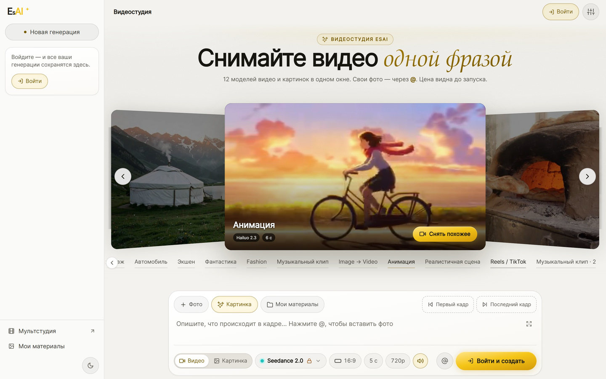
  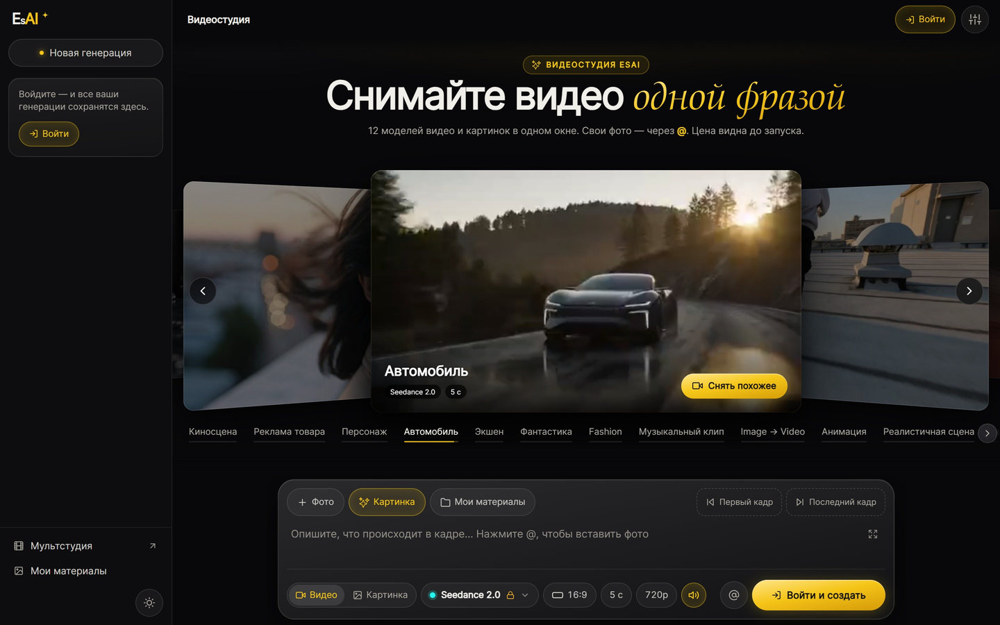
  <br>
  <sub>Video Studio in the light and dark themes: a scenario carousel of real EsAI generations above the composer</sub>
</p>

<p align="center">
  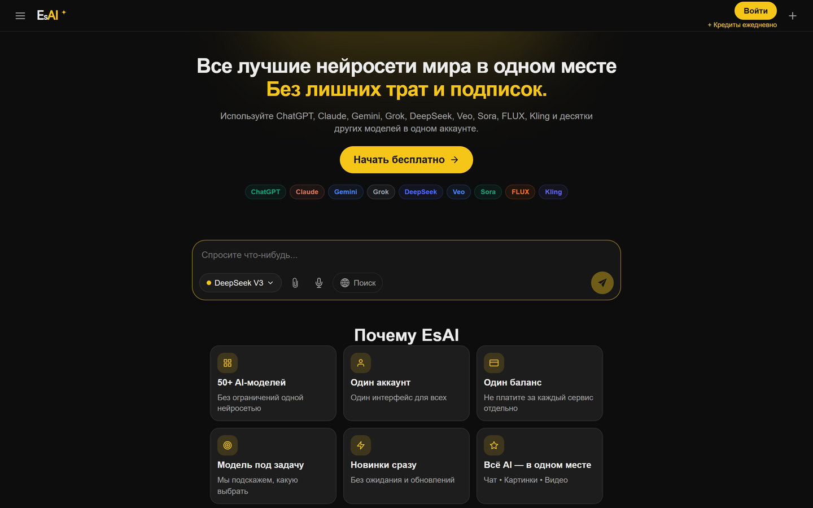
  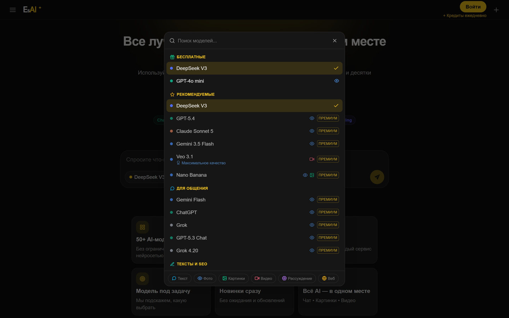
  <br>
  <sub>The home page is the chat (guests need no sign-up). The model picker lists free and premium LLMs plus image and video models.</sub>
</p>

<p align="center">
  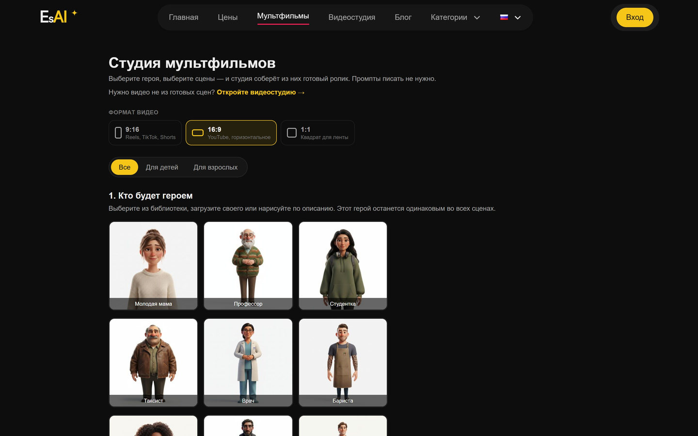
  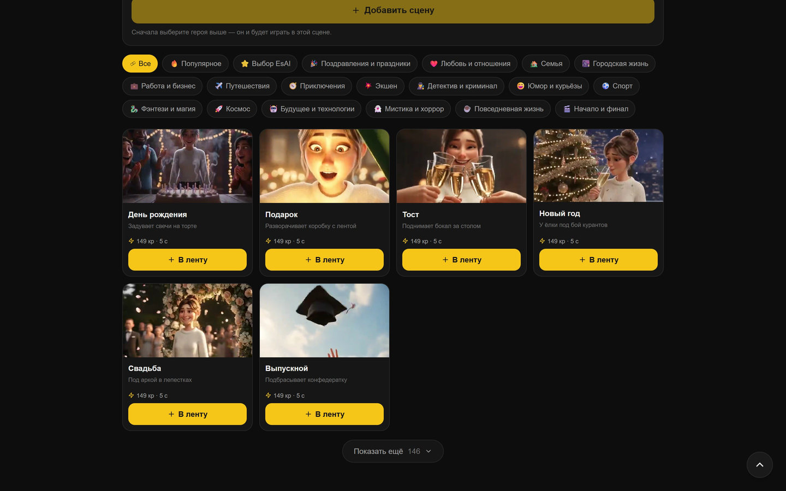
  <br>
  <sub>Cartoon Studio: pick a hero and a format, then choose scenes from the library</sub>
</p>

<details>
  <summary><b>More screenshots</b>: pricing, video models, light theme, EsAI Creators</summary>
  <br>
  <p align="center">
    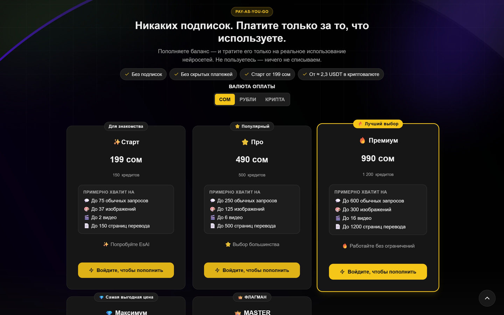
    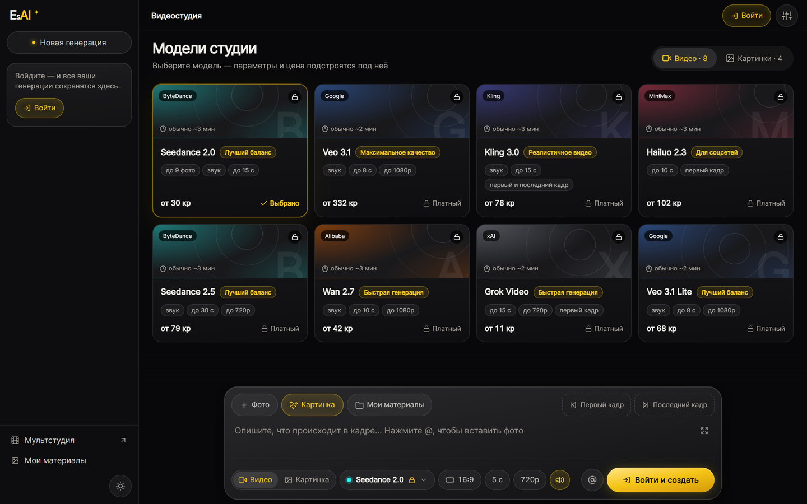
    <br>
    <sub>Pay-as-you-go credit packages · Video Studio models</sub>
  </p>
  <p align="center">
    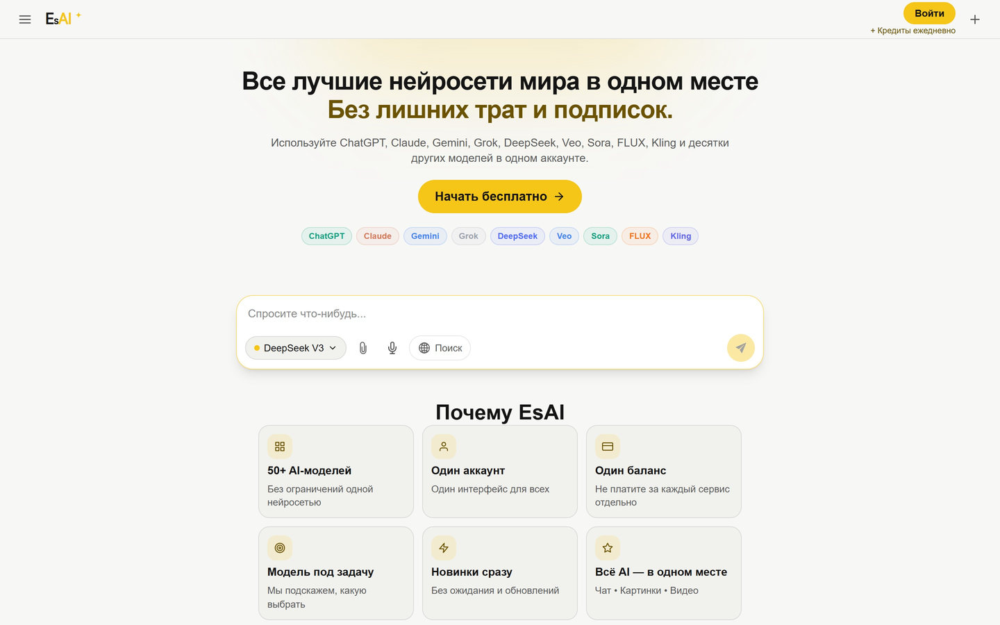
    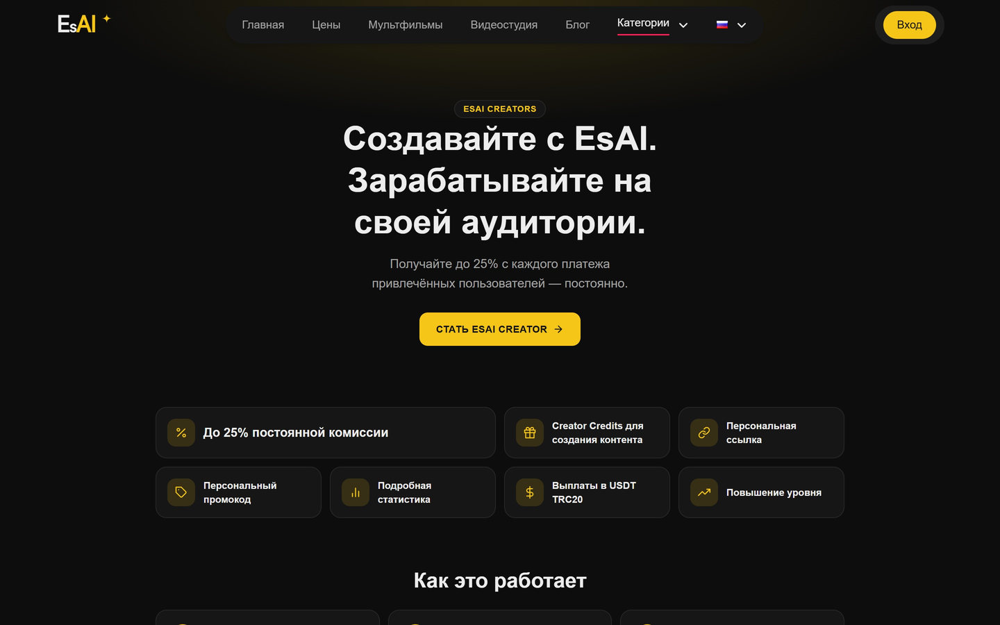
    <br>
    <sub>Home in the light theme · EsAI Creators partner program</sub>
  </p>
</details>

**On mobile**

<p align="center">
  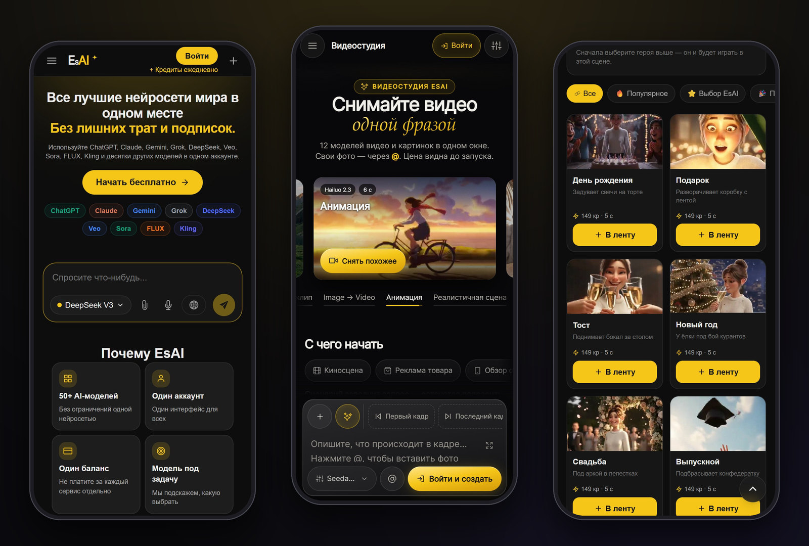
</p>

<details>
  <summary><b>All mobile screens</b></summary>
  <br>
  <p align="center">
    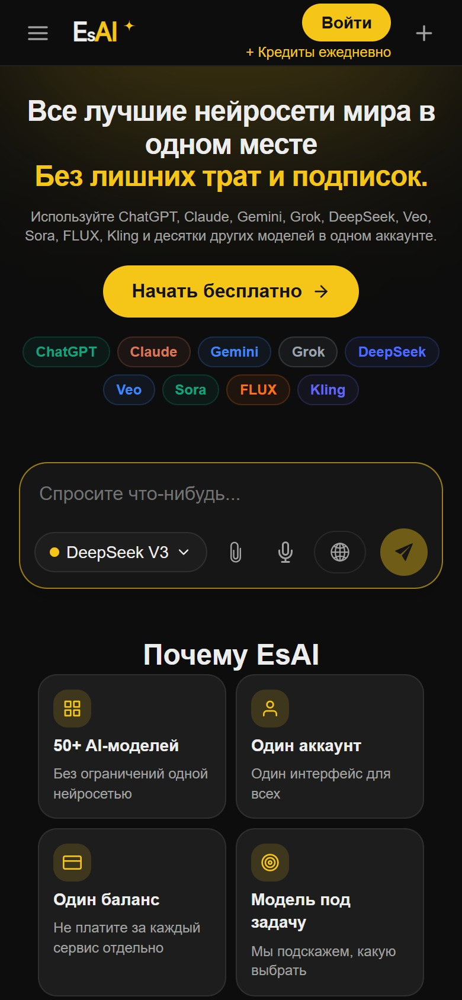
    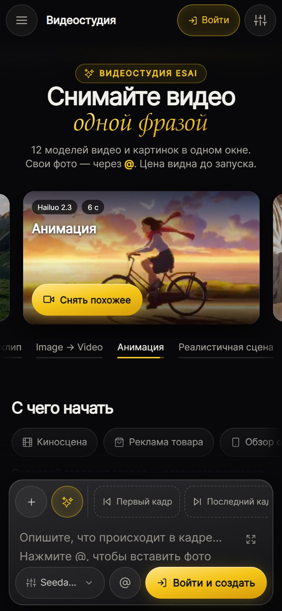
    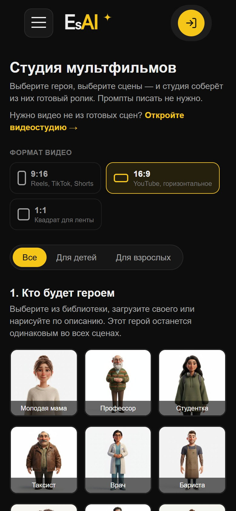
    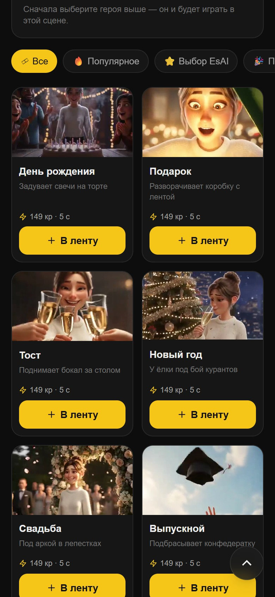
    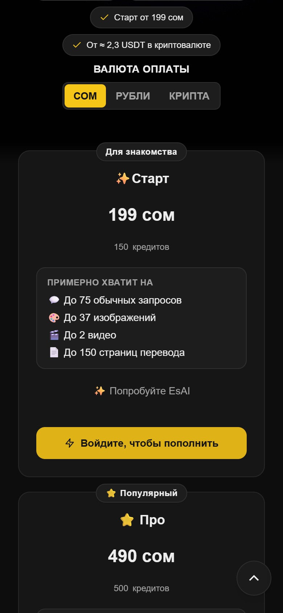
    <br>
    <sub>Home and chat · Video Studio · Cartoon Studio heroes · Cartoon Studio scenes · Pricing</sub>
  </p>
</details>

## Architecture

EsAI is a Docker Compose stack: a Next.js frontend and a Django API behind nginx, Celery workers on three queues, PostgreSQL and Redis. The Telegram bot is a thin client of the same API, so it does no billing and has no database access of its own.

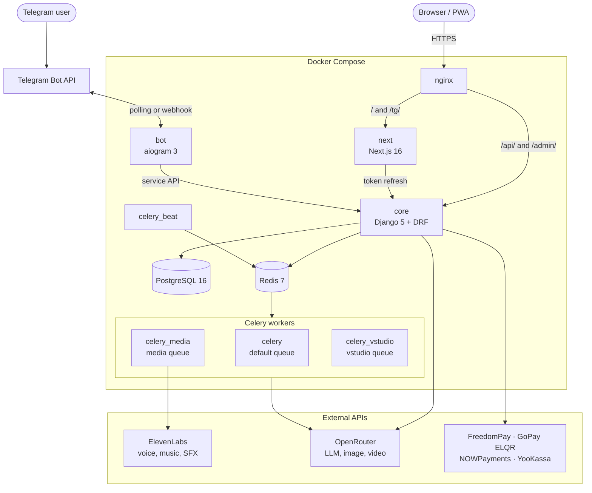

| Service | Role |
|---|---|
| `nginx` | Entry point. Routes `/` to Next.js and `/api/` and `/admin/` to Django, and serves `/static/` and `/media/`. The HTTPS overlay adds the Mini App (`/tg/`) and the bot webhook, which only accepts Telegram's networks |
| `next` | Next.js standalone server (App Router, SSR) |
| `core` | Django + DRF on gunicorn: API, auth, credits, payment callbacks and the admin API. Runs migrations on start |
| `celery` | Default queue: email, bonuses, notifications, payment reconciliation, Video Studio housekeeping |
| `celery_media` | `media` queue: chat and bot videos, Cartoon Studio scene renders, movie assembly and voice-over |
| `celery_vstudio` | `vstudio` queue: Video Studio takes |
| `celery_beat` | Scheduler (Asia/Bishkek): payment reconciles, bonuses, recovery of undelivered videos, OpenRouter account failover |
| `bot` | aiogram bot that talks only to the core API, using polling or a webhook |
| `db` · `redis` | PostgreSQL 16 · Redis 7 (Celery broker and results, Django cache, bot state) |
| `certbot` | Let's Encrypt certificates via webroot |

There are three compose files: `compose.yaml` (production over HTTP), `compose.https.yaml` (HTTPS overlay) and `compose.dev.yaml` (local development with `runserver`, `next dev` and one Celery worker for all queues).

## Tech stack

| Layer | Technologies |
|---|---|
| **Frontend** | Next.js 16 (App Router, standalone output) · React 19 · TypeScript 5.9 · Tailwind CSS 4 · Framer Motion · TipTap 3 (Video Studio editor) · i18next · react-markdown + highlight.js |
| **Backend** | Python 3.12 · Django 5.1 · Django REST Framework 3.15 · SimpleJWT · django-allauth (Google, Telegram) · gunicorn |
| **Background jobs** | Celery 5.5 with three queues · django-celery-beat · Redis 7 |
| **Data** | PostgreSQL 16 · append-only credit ledger |
| **AI providers** | OpenRouter (chat, images and video through the OpenAI SDK) · ElevenLabs (voices, music, sound effects) · ffmpeg (frame extraction, movie assembly) |
| **Documents** | pypdf · python-docx · openpyxl · python-pptx · Pillow with HEIF support |
| **Telegram** | aiogram 3.31 · httpx · pydantic-settings · Telegram Mini App with `initData` sign-in |
| **Payments** | FreedomPay (KGS) · GoPay ELQR · NOWPayments (crypto) · Telegram Stars · YooKassa (RUB) |
| **Infrastructure** | Docker Compose · nginx 1.27 · Let's Encrypt (certbot) · Web Push (VAPID) |

## Getting started

**Prerequisites:** Docker with the Compose plugin. An [OpenRouter](https://openrouter.ai) API key is needed for chat and generation, but the site loads without one. Node.js 22.6+ is needed only to run the frontend unit tests.

**1. Clone and configure**

```bash
git clone https://github.com/Wh0mever/EsAI.git
cd EsAI
cp .env.example .env
```

For local development, set these in `.env` and leave payment, OAuth and bot keys empty:

| Variable | Local value |
|---|---|
| `DJANGO_SECRET_KEY` | any random string |
| `POSTGRES_PASSWORD` | any value (`POSTGRES_HOST=db` is already set) |
| `SITE_BASE_URL` | `http://localhost` |
| `OPENROUTER_API_KEY` | your OpenRouter key, for chat and generation |

`DJANGO_ALLOWED_HOSTS` in the example already includes `localhost`, and `compose.dev.yaml` turns on `DJANGO_DEBUG`. A few variables, such as `EMAIL_HOST_PASSWORD` and `EXCHANGE_API_KEY`, must exist but can stay empty, as they are in `.env.example`.

**2. Start the dev stack**

```bash
docker compose -f compose.dev.yaml build
docker compose -f compose.dev.yaml up -d db redis
docker compose -f compose.dev.yaml run --rm core python manage.py migrate --noinput
docker compose -f compose.dev.yaml run --rm core python manage.py createsuperuser
docker compose -f compose.dev.yaml up -d core next celery celery_beat nginx
```

`createsuperuser` asks for an email and a password; this account opens both admin panels. Then open:

| URL | What |
|---|---|
| **http://localhost** | The app through nginx. Use this one, because the frontend calls `/api/` on the same origin |
| http://localhost/admin-new | Staff admin panel (sign in with the superuser) |
| http://localhost/admin/ | Django admin |
| http://localhost:3000 | Next.js dev server directly, with hot reload (API calls only work through port 80) |
| http://localhost:8000 | Django directly |

Follow the logs with `docker compose -f compose.dev.yaml logs -f` and stop the stack with `docker compose -f compose.dev.yaml down`.

**3. Optional seed data**

Run these with `docker compose -f compose.dev.yaml run --rm core python manage.py <command>`:

| Command | What it does |
|---|---|
| `seed_cartoon`, `seed_presets` | Cartoon Studio models and scene presets |
| `seed_package_i18n` | English and Kyrgyz translations for credit packages |
| `fill_model_descriptions` | Descriptions for the model catalogue |
| `ensure_socialapps` | Google and Telegram sign-in apps from env |
| `import_openrouter_key` | Registers the current OpenRouter key as an account in the admin panel |
| `fetch_rates` | Fetches RUB and KGS exchange rates against USD |

> [!WARNING]
> `render_previews`, `warm_keyframes` and `vstudio_shoot_showcase` call paid provider APIs and spend real money.

<details>
<summary><b>Running the Telegram bot locally</b></summary>
<br>

The bot is not part of `compose.dev.yaml`. Set `TELEGRAM_PRODUCT_BOT_TOKEN`, `TELEGRAM_PRODUCT_BOT_USERNAME`, `BOT_SERVICE_SECRET` (for example `openssl rand -hex 32`), `BOT_ACCESS=staff` and `BOT_STAFF_IDS` in `.env`, then run:

```bash
cd bot
pip install -r requirements.txt
BOT_API_BASE=http://127.0.0.1:8000 BOT_PUBLIC_HOST=127.0.0.1:8000 python -m bot
```

The bot also needs Redis (`BOT_REDIS_URL`, default `redis://redis:6379/3`). The dev compose file does not publish the Redis port, so point it at a Redis instance you can reach.

</details>

<details>
<summary><b>Running Django and Next.js without Docker</b></summary>
<br>

You need your own PostgreSQL 16 and Redis 7. Django reads `core/.env`, so put a copy of the settings there with `POSTGRES_HOST=localhost` and `REDIS_CACHE_URL` and `CELERY_BROKER_URL` pointed at your Redis. Then:

```bash
# terminal 1: Django
cd core
pip install -r requirements.txt
python manage.py migrate
python manage.py runserver

# terminal 2: Next.js
cd next
npm ci
npm run dev
```

The browser still needs a proxy that sends `/api/` to Django, as nginx does in Docker.

</details>

**4. Tests**

Backend tests use the Django test runner and need PostgreSQL, because some migrations use Postgres-only SQL. The dev stack provides it:

```bash
docker compose -f compose.dev.yaml run --rm core python manage.py test
# or only some apps:
docker compose -f compose.dev.yaml run --rm core python manage.py test vstudio creators payments
```

Telegram bot (`pytest` and `pytest-asyncio` are test-only dependencies):

```bash
cd bot
pip install -r requirements.txt pytest pytest-asyncio
python -m pytest tests -q
```

Frontend (Node.js 22.6+ for `--experimental-strip-types`):

```bash
cd next
npm ci
npm run test:vstudio     # Video Studio
npm run test:creators    # EsAI Creators
npm run test:qrpay       # ELQR checkout
npm run check:i18n       # ru / en / kg key parity
npx eslint .             # lint
```

**Production.** `scripts/up-http.sh` brings the stack up over HTTP, `scripts/issue-cert.sh` issues Let's Encrypt certificates and `scripts/up-https.sh` switches to HTTPS. See the docs below for details.

| Doc | Topic |
|---|---|
| [docs/DEPLOY.md](docs/DEPLOY.md) | Server deployment with a domain and HTTPS |
| [docs/UPDATE.md](docs/UPDATE.md) | Updating production |
| [docs/BACKUP_RESTORE.md](docs/BACKUP_RESTORE.md) | Database backup and restore |
| [docs/ADMIN.md](docs/ADMIN.md) | Admin panel |
| [docs/API.md](docs/API.md) | Main API endpoints |
| [docs/BOT.md](docs/BOT.md) | Telegram bot |

<sub>The docs are written in Russian.</sub>

## Configuration

All configuration comes from environment variables. [`.env.example`](.env.example) lists the names, grouped by area. Risky features ship behind an `off` / `staff` / `on` switch, so they can be tried by staff accounts first:

| Switch | Feature |
|---|---|
| `VSTUDIO_MODE` | Video Studio (`NEXT_PUBLIC_VSTUDIO_NAV=1` also adds it to the menu and sitemap) |
| `CRYPTO_PAYMENTS_MODE` | Crypto checkout (NOWPayments) |
| `GOPAY_MODE` | ELQR checkout (GoPay) |
| `KGS_METHODS_MODE` | Bank-app and card picker for KGS payments |
| `STARS_PAYMENTS_MODE` | Telegram Stars in the bot |
| `CREATORS_MODE` | EsAI Creators program |

Payment modes, provider keys and the Creators switch can also be changed at runtime in **/admin-new → Settings**, without a redeploy.

<details>
<summary><b>Environment variable reference</b> (names only)</summary>
<br>

| Group | Variables |
|---|---|
| Django | `DJANGO_SECRET_KEY`, `DJANGO_DEBUG`, `DJANGO_ALLOWED_HOSTS`, `CSRF_TRUSTED_ORIGINS`, `CORS_ALLOWED_ORIGINS`, `SITE_BASE_URL`, `DJANGO_SECURE_SSL_REDIRECT` |
| Email (SMTP) | `DEFAULT_FROM_EMAIL`, `EMAIL_HOST`, `EMAIL_PORT`, `EMAIL_USE_SSL`, `EMAIL_USE_TLS`, `EMAIL_HOST_USER`, `EMAIL_HOST_PASSWORD` |
| PostgreSQL | `POSTGRES_DB`, `POSTGRES_USER`, `POSTGRES_PASSWORD`, `POSTGRES_HOST`, `POSTGRES_PORT` |
| Redis and Celery | `REDIS_CACHE_URL`, `CELERY_BROKER_URL`, `CELERY_RESULT_BACKEND`, `CELERY_MEDIA_QUEUE`, `CELERY_MEDIA_CONCURRENCY`, `CELERY_VSTUDIO_QUEUE`, `CELERY_VSTUDIO_CONCURRENCY` |
| Frontend | `NEXT_PUBLIC_API_URL`, `NEXT_PUBLIC_SITE_URL`, `NEXT_PUBLIC_SUPPORT_EMAIL`, `NEXT_PUBLIC_VAPID_PUBLIC_KEY`, `NEXT_PUBLIC_VSTUDIO_NAV`, `NEXT_PUBLIC_CREATORS_NAV`, `INTERNAL_API_ORIGIN` |
| OpenRouter | `OPENROUTER_API_KEY`, `OPENROUTER_API_BASE`, `OPENROUTER_HTTP_REFERER`, `OPENROUTER_X_TITLE` |
| ElevenLabs | `ELEVENLABS_API_KEY`, `ELEVENLABS_TTS_MODEL` |
| FreedomPay (KGS) | `FREEDOM_PAY_MERCHANT_ID`, `FREEDOM_PAY_TOKEN`, `FREEDOM_PAY_PUBLIC_KEY`, `FREEDOM_PAY_API_BASE`, `FREEDOM_PAY_DEFAULT_CURRENCY`, `KGS_METHODS_MODE` |
| GoPay ELQR | `GOPAY_MODE`, `GOPAY_ENV`, `GOPAY_API_URL`, `GOPAY_LIFETIME_MINUTES`, `GOPAY_SEND_BUYER_EMAIL`, `GOPAY_TEST_API_KEY`, `GOPAY_TEST_API_SECRET`, `GOPAY_TEST_WEBHOOK_SECRET`, `GOPAY_LIVE_API_KEY`, `GOPAY_LIVE_API_SECRET`, `GOPAY_LIVE_WEBHOOK_SECRET` |
| Crypto (NOWPayments) | `CRYPTO_PAYMENTS_MODE`, `NOWPAYMENTS_API_KEY`, `NOWPAYMENTS_IPN_SECRET`, `NOWPAYMENTS_SANDBOX`, `NOWPAYMENTS_SETTLEMENT_CURRENCY`, `NOWPAYMENTS_API_URL`, `CURRENCY_KGS_TO_USD_RATE`, `CRYPTO_INVOICE_TTL_MINUTES`, `CRYPTO_ALLOWED_CURRENCIES`, `CRYPTO_FULL_TOLERANCE_PERCENT`, `CRYPTO_OVERPAY_CAP_PERCENT` |
| YooKassa (RUB) | `YOOKASSA_SHOP_ID`, `YOOKASSA_SECRET_KEY`, `YOOKASSA_API_URL` |
| Telegram Stars | `STARS_PAYMENTS_MODE` |
| Exchange rates | `EXCHANGE_API_KEY`, `EXCHANGE_API_BASE` |
| Sign-in | `GOOGLE_CLIENT_ID`, `GOOGLE_CLIENT_SECRET`, `TELEGRAM_BOT_TOKEN`, `TELEGRAM_BOT_ID`, `TELEGRAM_BOT_USERNAME`, optional `FACEBOOK_CLIENT_ID`, `FACEBOOK_CLIENT_SECRET`, `INSTAGRAM_CLIENT_ID`, `INSTAGRAM_CLIENT_SECRET` |
| Guest mode and limits | `GUEST_FREE_REQUESTS`, `DRF_THROTTLE_ANON`, `DRF_THROTTLE_USER`, `AUDIT_OPENROUTER_USD_PER_TOKEN` |
| Telegram bot | `TELEGRAM_PRODUCT_BOT_TOKEN`, `TELEGRAM_PRODUCT_BOT_USERNAME`, `BOT_SERVICE_SECRET`, `TELEGRAM_NOTIFY_ENABLED`, `BOT_ACCESS`, `BOT_STAFF_IDS`, `BOT_DEFAULT_MODEL`, `BOT_MODE`, `BOT_WEBHOOK_BASE`, `BOT_WEBHOOK_SECRET`, `BOT_WEBHOOK_PATH`, `BOT_WEBHOOK_PORT`, `STT_MODEL`, `STT_CREDITS_PER_MINUTE`, `STT_MAX_SECONDS` |
| Video Studio | `VSTUDIO_MODE`, `VSTUDIO_MAX_OPEN_VIDEO`, `VSTUDIO_MAX_OPEN_IMAGE`, `VSTUDIO_GIVE_UP_HOURS`, `VSTUDIO_INLINE_REFS`, `VSTUDIO_MIN_PROVIDER_USD`, `VSTUDIO_ASSIST_MODEL`, `VSTUDIO_PURGE_DAYS`, `DRF_THROTTLE_VSTUDIO_{READ,WRITE,QUOTE,RUN,POLL,UPLOAD,ASSIST}` |
| Web Push | `VAPID_PUBLIC_KEY`, `VAPID_PRIVATE_KEY`, `VAPID_SUBJECT` |
| EsAI Creators | `CREATORS_MODE`, `CREATORS_HOLD_DAYS`, `CREATORS_PAYOUTS_ENABLED`, `CREATORS_LINK_BASE` |

</details>

## Project structure

```
.
├── bot/                 Telegram bot (aiogram 3), thin client of the core API
│   ├── bot/             config, routers/, services/, middlewares/, keyboards/
│   └── tests/           pytest
├── core/                Django project
│   ├── core/            settings, urls, celery, wsgi/asgi
│   ├── ai/              chat, model catalogue, image/video jobs, speech-to-text, recovery
│   ├── vstudio/         Video Studio (projects, shots, takes, model capabilities, pricing, showcase)
│   ├── cartoon/         Cartoon Studio (characters, presets, scenes, audio, assembly)
│   ├── plans/           credits, packages, promo codes, tiers, Stars pricing
│   ├── payments/        FreedomPay, GoPay ELQR, NOWPayments, YooKassa, funnel, referral
│   ├── creators/        EsAI Creators program
│   ├── users/           auth (email code, Google, Telegram), memory, transfers, push, anti-fraud
│   ├── botapi/          service API for the bot, Stars, account linking, notifications
│   ├── adminapi/        /api/manage/* for the /admin-new panel, runtime settings
│   ├── audit/           event log, admin action log, metrics
│   ├── content/         blog, site settings, page SEO
│   └── mails/           SMTP mail and templates
├── next/                Next.js 16 frontend
│   ├── src/app/         App Router pages (public, /admin-new, /tg)
│   ├── src/components/  chat, vstudio, studio, pricing, creators, tg, pwa, …
│   ├── src/lib/         SEO data, payment helpers, i18n, theme
│   ├── src/locales/     ru / en / kg JSON namespaces
│   ├── public/          logos, icons, OG cover, service worker, llms.txt
│   └── scripts/         i18n parity check, OG image generator
├── nginx/               nginx.conf (HTTP), nginx-ssl.conf (HTTPS)
├── scripts/             dev and production start scripts, certificates, DB backup
├── docs/                deployment, updates, backups, admin, API, bot; README media
├── compose.yaml · compose.https.yaml · compose.dev.yaml
└── .env.example
```

## Languages

The interface ships in **Russian** (default), **Kyrgyz** and **English**. The language is detected automatically and can be switched in the header. Translations live in `next/src/locales/{ru,en,kg}/` as JSON namespaces, and `npm run check:i18n` checks that the three locales have the same keys. Credit packages have their own Russian, English and Kyrgyz names, descriptions and badges, which are edited in the admin panel.

## Security

- Secrets live only in environment variables. Never commit `.env`; [`.env.example`](.env.example) contains variable names and safe defaults only.
- Payment callbacks are verified before credits are added, either by signature or by re-fetching the payment from the provider. Scheduled jobs reconcile every payment method against the provider.
- Credits move through an append-only ledger. Video Studio reserves credits before a run and charges them only for a finished result.
- The admin panel requires a staff account, some actions require a superuser, and every admin action is logged.

**Reporting a vulnerability.** Please report it privately through [GitHub Security Advisories](../../security/advisories/new) ("Report a vulnerability" on the Security tab) and do not open a public issue.

## License

No open-source license is granted. All rights reserved.

Model and provider names are trademarks of their respective owners.

<p align="center">
  <a href="https://esai.kg">
    <picture>
      <source media="(prefers-color-scheme: dark)" srcset="docs/media/logo-dark.png">
      
    </picture>
  </a>
  <br>
  <sub><a href="https://esai.kg">esai.kg</a></sub>
</p>
