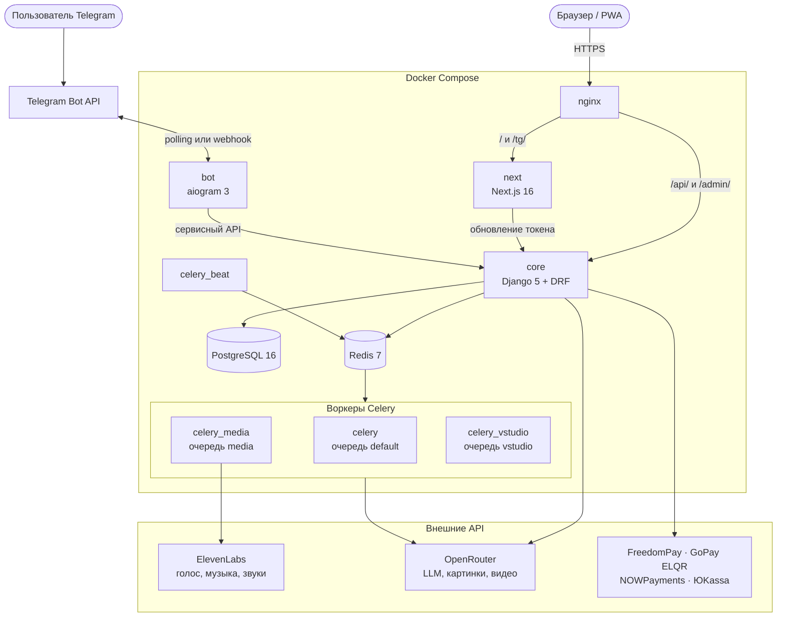

<p align="center"><a href="README.md">English</a> | <b>Русский</b></p>

<h1 align="center">
  <a href="https://esai.kg">
    <picture>
      <source media="(prefers-color-scheme: dark)" srcset="docs/media/logo-dark.png">
      
    </picture>
  </a>
</h1>

<p align="center">
  <b>Все AI в одном месте.</b> Чат с ведущими нейросетями, генерация картинок и видео<br>
  и озвученный мультфильм из одного героя. Оплата по факту в кыргызских сомах.
</p>

<p align="center">
  
  
  
  
  
  
  <br>
  
  
  
  
  
  
</p>

<p align="center">
  <a href="https://esai.kg"><b>Сайт</b></a> ·
  <a href="https://esai.kg/video-studio"><b>Видеостудия</b></a> ·
  <a href="https://esai.kg/studio"><b>Мультстудия</b></a> ·
  <a href="https://esai.kg/pricing"><b>Тарифы</b></a>
</p>

<p align="center"><b>Каждый кадр ниже сгенерирован в видеостудии EsAI</b></p>

<p align="center">
  <a href="https://esai.kg/video-studio">
    
  </a>
  <br>
  <sub>Анимация · Hailuo 2.3 &nbsp;|&nbsp; Киносцена · Veo 3.1 &nbsp;|&nbsp; Музыкальный клип · Seedance 2.0 &nbsp;|&nbsp; Fashion · Seedance 2.5 &nbsp;|&nbsp; Автомобиль · Seedance 2.0 &nbsp;|&nbsp; Реклама товара · Seedance 2.0</sub>
</p>

<p align="center">
  <a href="#что-такое-esai">Что такое EsAI</a> ·
  <a href="#возможности">Возможности</a> ·
  <a href="#сделано-в-esai">Сделано в EsAI</a> ·
  <a href="#скриншоты">Скриншоты</a> ·
  <a href="#архитектура">Архитектура</a> ·
  <a href="#технологии">Технологии</a> ·
  <a href="#быстрый-старт">Быстрый старт</a> ·
  <a href="#структура-проекта">Структура проекта</a> ·
  <a href="#безопасность">Безопасность</a>
</p>

## Что такое EsAI

**EsAI** ([esai.kg](https://esai.kg)) — сервис «всё в одном» для работы с ИИ, сделанный для Кыргызстана и стран СНГ. В одном чате доступны ведущие языковые модели (OpenAI GPT, Anthropic Claude, Google Gemini, DeepSeek, xAI Grok, Perplexity и другие, все через OpenRouter), а рядом — генерация картинок и видео, **видеостудия** для режиссируемых роликов и **мультстудия**, которая превращает героя и готовые сцены в озвученный мультфильм.

Подписки нет. Вы покупаете пакеты кредитов с ценой в сомах (KGS) и платите только за то, чем пользуетесь: банковской картой или через приложение банка, по единому QR-коду Кыргызстана **ELQR**, криптовалютой, а в боте — Telegram Stars. Гости могут попробовать чат без регистрации, а для входа хватит одноразового кода на почту, Google или Telegram. Один и тот же аккаунт и баланс работают на сайте, в устанавливаемом PWA, в Telegram-боте и в Telegram Mini App. Интерфейс доступен на русском, кыргызском и английском.

## Возможности

<table>
  <tr>
    <td width="50%" valign="top">
      💬 <b>Чат со многими моделями</b><br>
      GPT, Claude, Gemini, DeepSeek, Grok, Perplexity и другие через OpenRouter. Ответы в потоке, веб-поиск с источниками и голосовой ввод.
    </td>
    <td width="50%" valign="top">
      📄 <b>Анализ документов</b><br>
      Прикрепите PDF, Word, Excel, PowerPoint или TXT и задавайте вопросы по файлу прямо в чате.
    </td>
  </tr>
  <tr>
    <td valign="top">
      🧠 <b>Память и длинные чаты</b><br>
      Личная память, которую можно посмотреть, почистить или выключить. Сводка старых сообщений держит длинный диалог в контексте.
    </td>
    <td valign="top">
      🎨 <b>Генерация картинок</b><br>
      Nano Banana (Gemini image) и FLUX.2 Pro, Flex, Max и Klein, с выбором соотношения сторон и редактированием фото.
    </td>
  </tr>
  <tr>
    <td valign="top">
      🎬 <b>Видеостудия</b><br>
      Seedance, Veo 3.1, Kling, Hailuo, Wan и Grok Imagine в одном редакторе: свои фото через <code>@</code>, первый и последний кадр, цена до запуска. Кредиты списываются только за готовый результат.
    </td>
    <td valign="top">
      🧸 <b>Мультстудия</b><br>
      Выберите, загрузите или нарисуйте героя, снимите готовые сцены, добавьте голоса, музыку и звуковые эффекты (ElevenLabs) и получите собранный мультфильм.
    </td>
  </tr>
  <tr>
    <td valign="top">
      ✈️ <b>Telegram-бот и Mini App</b><br>
      Чат, файлы, голосовые, картинки, видео и вся мультстудия внутри Telegram — на том же аккаунте и балансе.
    </td>
    <td valign="top">
      💳 <b>Местные способы оплаты</b><br>
      Пакеты кредитов в сомах без подписки: карты и банковские приложения (FreedomPay), ELQR (GoPay), криптовалюта (NOWPayments), Telegram Stars, а также рубли через ЮKassa.
    </td>
  </tr>
  <tr>
    <td valign="top">
      🤝 <b>Инструменты роста</b><br>
      Реферальная ссылка с пожизненным процентом с покупок, программа EsAI Creators с выплатами в USDT, промокоды, переводы кредитов и ежедневные бонусы.
    </td>
    <td valign="top">
      📱 <b>PWA и уведомления</b><br>
      Веб-приложение с установкой и офлайн-страницей, Web Push и уведомления в Telegram о пополнениях и готовых видео.
    </td>
  </tr>
  <tr>
    <td valign="top">
      🌍 <b>Три языка и SEO</b><br>
      Интерфейс на русском, кыргызском и английском, динамический sitemap, <code>llms.txt</code>, JSON-LD, посадочные страницы моделей и задач и блог.
    </td>
    <td valign="top">
      🛠️ <b>Админка без кода</b><br>
      Модели, пакеты, платежи, воронка, витрина, сцены мультстудии, несколько аккаунтов OpenRouter с автопереключением и настройки без передеплоя.
    </td>
  </tr>
</table>

## Сделано в EsAI

Это ролики с главного экрана видеостудии — по одному на каждый из 12 сценариев. Для сетки плитки обрезаны до 9:16, а по клику открывается исходный MP4.

<table>
  <tr>
    <td align="center"><a href="https://esai.kg/media/vstudio/47/927552a0bf354ce7a7d979971b259c0e.mp4"></a><br><b>Кино&shy;сцена</b><br><sub>Veo 3.1 · 4&nbsp;с</sub></td>
    <td align="center"><a href="https://esai.kg/media/vstudio/47/d7279b82c2564b6ea9cd573cd4348d66.mp4"></a><br><b>Реклама товара</b><br><sub>Seedance 2.0 · 5&nbsp;с</sub></td>
    <td align="center"><a href="https://esai.kg/media/vstudio/47/4650e277d0a840e69ae175e96f1a9375.mp4"></a><br><b>Персо&shy;наж</b><br><sub>Kling 3.0 · 5&nbsp;с</sub></td>
    <td align="center"><a href="https://esai.kg/media/vstudio/47/1278c287fc4d4b1e97239c230093c0e3.mp4"></a><br><b>Авто&shy;мобиль</b><br><sub>Seedance 2.0 · 5&nbsp;с</sub></td>
  </tr>
  <tr>
    <td align="center"><a href="https://esai.kg/media/vstudio/47/b56b539a3928435cb8931b44c66289db.mp4"></a><br><b>Экшен</b><br><sub>Kling 3.0 · 5&nbsp;с</sub></td>
    <td align="center"><a href="https://esai.kg/media/vstudio/47/28bc430a982f4381ab7e61f1494696d7.mp4"></a><br><b>Фантас&shy;тика</b><br><sub>Seedance 2.5 · 5&nbsp;с</sub></td>
    <td align="center"><a href="https://esai.kg/media/vstudio/47/94f6bb5babba4bddb49c8e3d545b59b0.mp4"></a><br><b>Fashion</b><br><sub>Seedance 2.5 · 5&nbsp;с</sub></td>
    <td align="center"><a href="https://esai.kg/media/vstudio/47/6350d79a023e410b8bd7b437eeb36088.mp4"></a><br><b>Музы&shy;кальный клип</b><br><sub>Seedance 2.0 · 5&nbsp;с</sub></td>
  </tr>
  <tr>
    <td align="center"><a href="https://esai.kg/media/vstudio/47/fd326293e0a340679b9a1a4c45c3361e.mp4"></a><br><b>Image → Video</b><br><sub>Seedance 2.0 · 5&nbsp;с</sub></td>
    <td align="center"><a href="https://esai.kg/media/vstudio/47/d68270b8f3fd4864afefefcb3f0a336e.mp4"></a><br><b>Ани&shy;мация</b><br><sub>Hailuo 2.3 · 6&nbsp;с</sub></td>
    <td align="center"><a href="https://esai.kg/media/vstudio/47/cc7a50034b0a4e5dbd086cf361055bfb.mp4"></a><br><b>Реалис&shy;тичная сцена</b><br><sub>Veo 3.1 Lite · 4&nbsp;с</sub></td>
    <td align="center"><a href="https://esai.kg/media/vstudio/47/1362769ccc9049f1980c917e6579e2d9.mp4"></a><br><b>Reels / TikTok</b><br><sub>Seedance 2.0 · 5&nbsp;с</sub></td>
  </tr>
</table>

**Мультстудия.** Ниже — готовые сцены из библиотеки студии. Вы выбираете героя, снимаете понравившиеся сцены, озвучиваете их и получаете один собранный мультфильм.

<table>
  <tr>
    <td align="center"><a href="https://esai.kg/studio"></a><br><b>Под водой</b><br><sub>5&nbsp;с</sub></td>
    <td align="center"><a href="https://esai.kg/studio"></a><br><b>Встреча с дино&shy;завром</b><br><sub>5&nbsp;с</sub></td>
    <td align="center"><a href="https://esai.kg/studio"></a><br><b>Смешное падение</b><br><sub>4&nbsp;с</sub></td>
    <td align="center"><a href="https://esai.kg/studio"></a><br><b>Пират&shy;ский корабль</b><br><sub>5&nbsp;с</sub></td>
  </tr>
</table>

## Скриншоты

<p align="center">
  
  
  <br>
  <sub>Видеостудия в светлой и тёмной теме: карусель сценариев из настоящих генераций EsAI над редактором запроса</sub>
</p>

<p align="center">
  
  
  <br>
  <sub>Главная страница — это и есть чат (гостям регистрация не нужна). В выборе модели — бесплатные и премиум LLM, модели картинок и видео.</sub>
</p>

<p align="center">
  
  
  <br>
  <sub>Мультстудия: выберите героя и формат, затем сцены из библиотеки</sub>
</p>

<details>
  <summary><b>Ещё скриншоты</b>: тарифы, модели видео, светлая тема, EsAI Creators</summary>
  <br>
  <p align="center">
    
    
    <br>
    <sub>Пакеты кредитов без подписки · Модели видеостудии</sub>
  </p>
  <p align="center">
    
    
    <br>
    <sub>Главная в светлой теме · Партнёрская программа EsAI Creators</sub>
  </p>
</details>

**На телефоне**

<p align="center">
  
</p>

<details>
  <summary><b>Все мобильные экраны</b></summary>
  <br>
  <p align="center">
    
    
    
    
    
    <br>
    <sub>Главная и чат · Видеостудия · Герои мультстудии · Сцены мультстудии · Тарифы</sub>
  </p>
</details>

## Архитектура

EsAI — это стек на Docker Compose: фронтенд на Next.js и API на Django за nginx, воркеры Celery на трёх очередях, PostgreSQL и Redis. Telegram-бот — тонкий клиент того же API: он не ведёт биллинг и не обращается к базе напрямую.



| Сервис | Роль |
|---|---|
| `nginx` | Точка входа. Отправляет `/` в Next.js, `/api/` и `/admin/` в Django, отдаёт `/static/` и `/media/`. HTTPS-оверлей добавляет Mini App (`/tg/`) и вебхук бота, который принимает запросы только из сетей Telegram |
| `next` | Сервер Next.js в режиме standalone (App Router, SSR) |
| `core` | Django + DRF на gunicorn: API, авторизация, кредиты, колбэки платежей и API админки. При старте применяет миграции |
| `celery` | Очередь по умолчанию: почта, бонусы, уведомления, сверка платежей, обслуживание видеостудии |
| `celery_media` | Очередь `media`: видео из чата и бота, рендер сцен мультстудии, сборка мультфильма и озвучка |
| `celery_vstudio` | Очередь `vstudio`: дубли видеостудии |
| `celery_beat` | Планировщик (Asia/Bishkek): сверка платежей, бонусы, довыдача недоставленных видео, переключение аккаунтов OpenRouter |
| `bot` | Бот на aiogram, общается только с API core, через polling или вебхук |
| `db` · `redis` | PostgreSQL 16 · Redis 7 (брокер и результаты Celery, кэш Django, состояние бота) |
| `certbot` | Сертификаты Let's Encrypt через webroot |

Файлов compose три: `compose.yaml` (продакшен по HTTP), `compose.https.yaml` (HTTPS-оверлей) и `compose.dev.yaml` (локальная разработка: `runserver`, `next dev` и один воркер Celery на все очереди).

## Технологии

| Слой | Технологии |
|---|---|
| **Фронтенд** | Next.js 16 (App Router, standalone) · React 19 · TypeScript 5.9 · Tailwind CSS 4 · Framer Motion · TipTap 3 (редактор видеостудии) · i18next · react-markdown + highlight.js |
| **Бэкенд** | Python 3.12 · Django 5.1 · Django REST Framework 3.15 · SimpleJWT · django-allauth (Google, Telegram) · gunicorn |
| **Фоновые задачи** | Celery 5.5 на трёх очередях · django-celery-beat · Redis 7 |
| **Данные** | PostgreSQL 16 · журнал кредитов только на добавление |
| **AI-провайдеры** | OpenRouter (чат, картинки и видео через OpenAI SDK) · ElevenLabs (голоса, музыка, звуковые эффекты) · ffmpeg (кадры, сборка фильма) |
| **Документы** | pypdf · python-docx · openpyxl · python-pptx · Pillow с поддержкой HEIF |
| **Telegram** | aiogram 3.31 · httpx · pydantic-settings · Telegram Mini App со входом по `initData` |
| **Платежи** | FreedomPay (KGS) · GoPay ELQR · NOWPayments (крипта) · Telegram Stars · ЮKassa (RUB) |
| **Инфраструктура** | Docker Compose · nginx 1.27 · Let's Encrypt (certbot) · Web Push (VAPID) |

## Быстрый старт

**Что нужно:** Docker с плагином Compose. Для чата и генераций нужен ключ API [OpenRouter](https://openrouter.ai), но сайт открывается и без него. Node.js 22.6+ нужен только для юнит-тестов фронтенда.

**1. Клонировать и настроить**

```bash
git clone https://github.com/Wh0mever/EsAI.git
cd EsAI
cp .env.example .env
```

Для локальной разработки задайте в `.env` эти значения, а ключи платежей, OAuth и бота оставьте пустыми:

| Переменная | Локальное значение |
|---|---|
| `DJANGO_SECRET_KEY` | любая случайная строка |
| `POSTGRES_PASSWORD` | любое значение (`POSTGRES_HOST=db` уже задан) |
| `SITE_BASE_URL` | `http://localhost` |
| `OPENROUTER_API_KEY` | ваш ключ OpenRouter, для чата и генераций |

`DJANGO_ALLOWED_HOSTS` в примере уже содержит `localhost`, а `compose.dev.yaml` включает `DJANGO_DEBUG`. Несколько переменных, например `EMAIL_HOST_PASSWORD` и `EXCHANGE_API_KEY`, должны существовать, но могут быть пустыми — так они и заданы в `.env.example`.

**2. Запустить dev-стек**

```bash
docker compose -f compose.dev.yaml build
docker compose -f compose.dev.yaml up -d db redis
docker compose -f compose.dev.yaml run --rm core python manage.py migrate --noinput
docker compose -f compose.dev.yaml run --rm core python manage.py createsuperuser
docker compose -f compose.dev.yaml up -d core next celery celery_beat nginx
```

`createsuperuser` спросит почту и пароль; с этим аккаунтом открываются обе админки. Дальше откройте:

| Адрес | Что там |
|---|---|
| **http://localhost** | Приложение через nginx. Открывайте его: фронтенд ходит в `/api/` на том же домене |
| http://localhost/admin-new | Админ-панель для сотрудников (вход суперпользователем) |
| http://localhost/admin/ | Админка Django |
| http://localhost:3000 | Dev-сервер Next.js напрямую, с горячей перезагрузкой (API работает только через порт 80) |
| http://localhost:8000 | Django напрямую |

Логи: `docker compose -f compose.dev.yaml logs -f`, остановка: `docker compose -f compose.dev.yaml down`.

**3. Начальные данные (по желанию)**

Запуск: `docker compose -f compose.dev.yaml run --rm core python manage.py <команда>`.

| Команда | Что делает |
|---|---|
| `seed_cartoon`, `seed_presets` | Модели и пресеты сцен мультстудии |
| `seed_package_i18n` | Английские и кыргызские переводы пакетов кредитов |
| `fill_model_descriptions` | Описания для каталога моделей |
| `ensure_socialapps` | Приложения входа через Google и Telegram из env |
| `import_openrouter_key` | Заводит текущий ключ OpenRouter как аккаунт в админке |
| `fetch_rates` | Загружает курсы RUB и KGS к USD |

> [!WARNING]
> `render_previews`, `warm_keyframes` и `vstudio_shoot_showcase` вызывают платные API провайдеров и тратят реальные деньги.

<details>
<summary><b>Telegram-бот локально</b></summary>
<br>

Бота нет в `compose.dev.yaml`. Задайте в `.env` `TELEGRAM_PRODUCT_BOT_TOKEN`, `TELEGRAM_PRODUCT_BOT_USERNAME`, `BOT_SERVICE_SECRET` (например, `openssl rand -hex 32`), `BOT_ACCESS=staff` и `BOT_STAFF_IDS`, затем запустите:

```bash
cd bot
pip install -r requirements.txt
BOT_API_BASE=http://127.0.0.1:8000 BOT_PUBLIC_HOST=127.0.0.1:8000 python -m bot
```

Боту также нужен Redis (`BOT_REDIS_URL`, по умолчанию `redis://redis:6379/3`). Dev-compose не публикует порт Redis, поэтому укажите доступный вам экземпляр Redis.

</details>

<details>
<summary><b>Django и Next.js без Docker</b></summary>
<br>

Понадобятся свои PostgreSQL 16 и Redis 7. Django читает `core/.env`, поэтому положите туда копию настроек с `POSTGRES_HOST=localhost`, а `REDIS_CACHE_URL` и `CELERY_BROKER_URL` направьте на ваш Redis. Затем:

```bash
# терминал 1: Django
cd core
pip install -r requirements.txt
python manage.py migrate
python manage.py runserver

# терминал 2: Next.js
cd next
npm ci
npm run dev
```

Браузеру всё равно нужен прокси, который отправляет `/api/` в Django, как это делает nginx в Docker.

</details>

**4. Тесты**

Тесты бэкенда запускаются через Django test runner и требуют PostgreSQL: часть миграций использует SQL, специфичный для Postgres. Dev-стек его поднимает:

```bash
docker compose -f compose.dev.yaml run --rm core python manage.py test
# или только некоторые приложения:
docker compose -f compose.dev.yaml run --rm core python manage.py test vstudio creators payments
```

Telegram-бот (`pytest` и `pytest-asyncio` нужны только для тестов):

```bash
cd bot
pip install -r requirements.txt pytest pytest-asyncio
python -m pytest tests -q
```

Фронтенд (Node.js 22.6+ из-за `--experimental-strip-types`):

```bash
cd next
npm ci
npm run test:vstudio     # видеостудия
npm run test:creators    # EsAI Creators
npm run test:qrpay       # оплата по ELQR
npm run check:i18n       # одинаковые ключи в ru / en / kg
npx eslint .             # линтер
```

**Продакшен.** `scripts/up-http.sh` поднимает стек по HTTP, `scripts/issue-cert.sh` выпускает сертификаты Let's Encrypt, а `scripts/up-https.sh` переключает на HTTPS. Подробности — в документации:

| Документ | Тема |
|---|---|
| [docs/DEPLOY.md](docs/DEPLOY.md) | Развёртывание на сервере с доменом и HTTPS |
| [docs/UPDATE.md](docs/UPDATE.md) | Обновление продакшена |
| [docs/BACKUP_RESTORE.md](docs/BACKUP_RESTORE.md) | Бэкап и восстановление базы |
| [docs/ADMIN.md](docs/ADMIN.md) | Админ-панель |
| [docs/API.md](docs/API.md) | Основные эндпоинты API |
| [docs/BOT.md](docs/BOT.md) | Telegram-бот |

## Настройка

Вся настройка — через переменные окружения. В [`.env.example`](.env.example) перечислены их имена по разделам. Рискованные функции выкатываются через переключатель `off` / `staff` / `on`, чтобы сначала их могли попробовать сотрудники:

| Переключатель | Функция |
|---|---|
| `VSTUDIO_MODE` | Видеостудия (`NEXT_PUBLIC_VSTUDIO_NAV=1` ещё и добавляет её в меню и sitemap) |
| `CRYPTO_PAYMENTS_MODE` | Оплата криптовалютой (NOWPayments) |
| `GOPAY_MODE` | Оплата по ELQR (GoPay) |
| `KGS_METHODS_MODE` | Выбор банковского приложения или карты для оплаты в сомах |
| `STARS_PAYMENTS_MODE` | Telegram Stars в боте |
| `CREATORS_MODE` | Программа EsAI Creators |

Режимы оплаты, ключи провайдеров и переключатель Creators можно менять и на лету в **/admin-new → Настройки**, без передеплоя.

<details>
<summary><b>Справочник переменных окружения</b> (только имена)</summary>
<br>

| Раздел | Переменные |
|---|---|
| Django | `DJANGO_SECRET_KEY`, `DJANGO_DEBUG`, `DJANGO_ALLOWED_HOSTS`, `CSRF_TRUSTED_ORIGINS`, `CORS_ALLOWED_ORIGINS`, `SITE_BASE_URL`, `DJANGO_SECURE_SSL_REDIRECT` |
| Почта (SMTP) | `DEFAULT_FROM_EMAIL`, `EMAIL_HOST`, `EMAIL_PORT`, `EMAIL_USE_SSL`, `EMAIL_USE_TLS`, `EMAIL_HOST_USER`, `EMAIL_HOST_PASSWORD` |
| PostgreSQL | `POSTGRES_DB`, `POSTGRES_USER`, `POSTGRES_PASSWORD`, `POSTGRES_HOST`, `POSTGRES_PORT` |
| Redis и Celery | `REDIS_CACHE_URL`, `CELERY_BROKER_URL`, `CELERY_RESULT_BACKEND`, `CELERY_MEDIA_QUEUE`, `CELERY_MEDIA_CONCURRENCY`, `CELERY_VSTUDIO_QUEUE`, `CELERY_VSTUDIO_CONCURRENCY` |
| Фронтенд | `NEXT_PUBLIC_API_URL`, `NEXT_PUBLIC_SITE_URL`, `NEXT_PUBLIC_SUPPORT_EMAIL`, `NEXT_PUBLIC_VAPID_PUBLIC_KEY`, `NEXT_PUBLIC_VSTUDIO_NAV`, `NEXT_PUBLIC_CREATORS_NAV`, `INTERNAL_API_ORIGIN` |
| OpenRouter | `OPENROUTER_API_KEY`, `OPENROUTER_API_BASE`, `OPENROUTER_HTTP_REFERER`, `OPENROUTER_X_TITLE` |
| ElevenLabs | `ELEVENLABS_API_KEY`, `ELEVENLABS_TTS_MODEL` |
| FreedomPay (KGS) | `FREEDOM_PAY_MERCHANT_ID`, `FREEDOM_PAY_TOKEN`, `FREEDOM_PAY_PUBLIC_KEY`, `FREEDOM_PAY_API_BASE`, `FREEDOM_PAY_DEFAULT_CURRENCY`, `KGS_METHODS_MODE` |
| GoPay ELQR | `GOPAY_MODE`, `GOPAY_ENV`, `GOPAY_API_URL`, `GOPAY_LIFETIME_MINUTES`, `GOPAY_SEND_BUYER_EMAIL`, `GOPAY_TEST_API_KEY`, `GOPAY_TEST_API_SECRET`, `GOPAY_TEST_WEBHOOK_SECRET`, `GOPAY_LIVE_API_KEY`, `GOPAY_LIVE_API_SECRET`, `GOPAY_LIVE_WEBHOOK_SECRET` |
| Крипта (NOWPayments) | `CRYPTO_PAYMENTS_MODE`, `NOWPAYMENTS_API_KEY`, `NOWPAYMENTS_IPN_SECRET`, `NOWPAYMENTS_SANDBOX`, `NOWPAYMENTS_SETTLEMENT_CURRENCY`, `NOWPAYMENTS_API_URL`, `CURRENCY_KGS_TO_USD_RATE`, `CRYPTO_INVOICE_TTL_MINUTES`, `CRYPTO_ALLOWED_CURRENCIES`, `CRYPTO_FULL_TOLERANCE_PERCENT`, `CRYPTO_OVERPAY_CAP_PERCENT` |
| ЮKassa (RUB) | `YOOKASSA_SHOP_ID`, `YOOKASSA_SECRET_KEY`, `YOOKASSA_API_URL` |
| Telegram Stars | `STARS_PAYMENTS_MODE` |
| Курсы валют | `EXCHANGE_API_KEY`, `EXCHANGE_API_BASE` |
| Вход | `GOOGLE_CLIENT_ID`, `GOOGLE_CLIENT_SECRET`, `TELEGRAM_BOT_TOKEN`, `TELEGRAM_BOT_ID`, `TELEGRAM_BOT_USERNAME`, по желанию `FACEBOOK_CLIENT_ID`, `FACEBOOK_CLIENT_SECRET`, `INSTAGRAM_CLIENT_ID`, `INSTAGRAM_CLIENT_SECRET` |
| Гостевой режим и лимиты | `GUEST_FREE_REQUESTS`, `DRF_THROTTLE_ANON`, `DRF_THROTTLE_USER`, `AUDIT_OPENROUTER_USD_PER_TOKEN` |
| Telegram-бот | `TELEGRAM_PRODUCT_BOT_TOKEN`, `TELEGRAM_PRODUCT_BOT_USERNAME`, `BOT_SERVICE_SECRET`, `TELEGRAM_NOTIFY_ENABLED`, `BOT_ACCESS`, `BOT_STAFF_IDS`, `BOT_DEFAULT_MODEL`, `BOT_MODE`, `BOT_WEBHOOK_BASE`, `BOT_WEBHOOK_SECRET`, `BOT_WEBHOOK_PATH`, `BOT_WEBHOOK_PORT`, `STT_MODEL`, `STT_CREDITS_PER_MINUTE`, `STT_MAX_SECONDS` |
| Видеостудия | `VSTUDIO_MODE`, `VSTUDIO_MAX_OPEN_VIDEO`, `VSTUDIO_MAX_OPEN_IMAGE`, `VSTUDIO_GIVE_UP_HOURS`, `VSTUDIO_INLINE_REFS`, `VSTUDIO_MIN_PROVIDER_USD`, `VSTUDIO_ASSIST_MODEL`, `VSTUDIO_PURGE_DAYS`, `DRF_THROTTLE_VSTUDIO_{READ,WRITE,QUOTE,RUN,POLL,UPLOAD,ASSIST}` |
| Web Push | `VAPID_PUBLIC_KEY`, `VAPID_PRIVATE_KEY`, `VAPID_SUBJECT` |
| EsAI Creators | `CREATORS_MODE`, `CREATORS_HOLD_DAYS`, `CREATORS_PAYOUTS_ENABLED`, `CREATORS_LINK_BASE` |

</details>

## Структура проекта

```
.
├── bot/                 Telegram-бот (aiogram 3), тонкий клиент API core
│   ├── bot/             config, routers/, services/, middlewares/, keyboards/
│   └── tests/           pytest
├── core/                Django-проект
│   ├── core/            settings, urls, celery, wsgi/asgi
│   ├── ai/              чат, каталог моделей, задания картинок и видео, распознавание речи, довыдача
│   ├── vstudio/         видеостудия (проекты, шоты, дубли, возможности моделей, цены, витрина)
│   ├── cartoon/         мультстудия (герои, пресеты, сцены, звук, сборка)
│   ├── plans/           кредиты, пакеты, промокоды, уровни доступа, цены в Stars
│   ├── payments/        FreedomPay, GoPay ELQR, NOWPayments, ЮKassa, воронка, рефералка
│   ├── creators/        программа EsAI Creators
│   ├── users/           вход (код на почту, Google, Telegram), память, переводы, push, антифрод
│   ├── botapi/          сервисный API для бота, Stars, привязка аккаунтов, уведомления
│   ├── adminapi/        /api/manage/* для панели /admin-new, настройки на лету
│   ├── audit/           журнал событий, журнал действий админов, метрики
│   ├── content/         блог, настройки сайта, SEO страниц
│   └── mails/           SMTP-почта и шаблоны
├── next/                фронтенд на Next.js 16
│   ├── src/app/         страницы App Router (публичные, /admin-new, /tg)
│   ├── src/components/  chat, vstudio, studio, pricing, creators, tg, pwa, …
│   ├── src/lib/         SEO-данные, помощники платежей, i18n, тема
│   ├── src/locales/     JSON-пространства ru / en / kg
│   ├── public/          логотипы, иконки, OG-обложка, service worker, llms.txt
│   └── scripts/         проверка паритета i18n, генератор OG-картинки
├── nginx/               nginx.conf (HTTP), nginx-ssl.conf (HTTPS)
├── scripts/             запуск dev и продакшена, сертификаты, бэкап БД
├── docs/                деплой, обновления, бэкапы, админка, API, бот; медиа для README
├── compose.yaml · compose.https.yaml · compose.dev.yaml
└── .env.example
```

## Языки

Интерфейс доступен на **русском** (по умолчанию), **кыргызском** и **английском**. Язык определяется автоматически, его можно сменить в шапке сайта. Переводы лежат в `next/src/locales/{ru,en,kg}/` как JSON-пространства имён, а `npm run check:i18n` проверяет, что ключи во всех трёх локалях совпадают. У пакетов кредитов свои названия, описания и бейджи на русском, английском и кыргызском — их правят в админке.

## Безопасность

- Секреты хранятся только в переменных окружения. Никогда не коммитьте `.env`; в [`.env.example`](.env.example) только имена переменных и безопасные значения по умолчанию.
- Колбэки платежей проверяются до зачисления кредитов: по подписи или повторным запросом платежа у провайдера. Плановые задачи сверяют каждый способ оплаты с провайдером.
- Кредиты движутся через журнал, в который только добавляются записи. Видеостудия резервирует кредиты перед запуском и списывает их только за готовый результат.
- Админка требует аккаунт сотрудника, часть действий — суперпользователя, и каждое действие админа записывается в журнал.

**Нашли уязвимость?** Сообщите о ней приватно через [GitHub Security Advisories](../../security/advisories/new) (кнопка «Report a vulnerability» на вкладке Security) и не открывайте публичный issue.

## Лицензия

Открытая лицензия не предоставляется. Все права защищены.

Названия моделей и провайдеров — товарные знаки их владельцев.

<p align="center">
  <a href="https://esai.kg">
    <picture>
      <source media="(prefers-color-scheme: dark)" srcset="docs/media/logo-dark.png">
      
    </picture>
  </a>
  <br>
  <sub><a href="https://esai.kg">esai.kg</a></sub>
</p>
